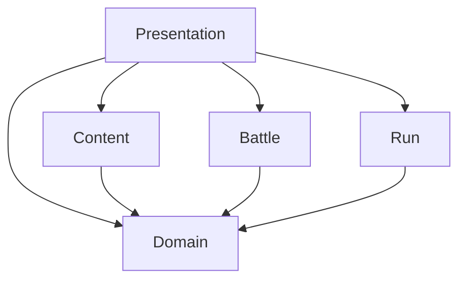

# 模块与协作

运行时代码位于 `Assets/RaidPartyManager`。依赖由程序集定义约束。



| 模块 | 负责的状态或契约 | 可独立开发的方式 |
|---|---|---|
| Domain | 角色和装备定义、站位、开战快照与结果 | 只放跨模块共同使用的类型。修改契约时同时更新本页和受影响的测试 |
| Battle | 单场内部的行动时钟、生命、护盾、决策与事件 | 从内存构造战斗输入，用 `BattleTests` 验证规则 |
| Run | 队员实例、站位、当前生命、背包、配装与战后结算 | 用构造的战斗结果验证流程，见 `PartyRunTests` |
| Content | 角色、装备和遭遇的 Unity 资源，以及到运行时数据的转换 | 在 `PrototypeData` 下编辑独立的资源。通过 Create → Raid Party Manager 添加内容 |
| Presentation | 场景组装、玩家操作、战斗回放与结算展示 | 用固定的请求、结果和事件验证显示。用实际场景跑 Play Mode 测试 |

## 开战与结算

```csharp
var request = run.BeginBattle(encounter.Enemies, encounter.TickLimit, encounter.VictoryReward);
var result = new BattleSimulator().Simulate(request);
// 界面用 request 初始化站位和生命，并依次播放 result.Events。
bool settled = run.TrySettle(result, out var reward);
```

- **标识**。内容资源上的角色、装备 ID 标识定义。遭遇里手动指定队员和敌人实例 ID，场内唯一。装备实例和战斗 ID 在一个 `PartyRun` 内递增。重置演练创建新的 `PartyRun`。
- **快照**。`BattleRequest` 包含当前生命、配装后的属性、角色定义和站位。模拟器复制需要变更的战斗状态。它不读取 Unity 场景、界面或背包。
- **事件**。行动事件带发生时间、行动者、目标、决策理由、实际生命变化量或护盾增加量，以及目标行动后的生命与剩余护盾。倒下事件紧随导致倒下的行动。最后一个事件是结束标记，结果中的战斗 ID 与输入一致。
- **战后写回**。`PartyRun` 检查结果属于当前战斗且合法覆盖参战单位，再写入生命、清除倒下队员的站位并发奖。没有未结算的当前战斗时，重复结算返回 `false`。围绕同一次战斗的界面按钮应复用这条流程。
- **AI 扩展**。`IDecisionPolicy.Choose` 接收只读候选和当前决策上下文，返回候选下标和理由。目标合法性和实际执行由模拟器负责。后续战术功能应通过这一入口加入偏好，运行时仍由 AI 选出合法行动。
- **进化扩展**。由将来的道具或事件系统确认条件并消费资源，再调用 `TryChangeForm`。队员实例与装备槽保留，应用新形态的基础属性。进化分支、消耗和继承规则应由负责养成的模块确定。

## 战斗界面

`BattlePrototype` 负责布阵、配装、回放和结算。`BattleUnitCard` 根据行动事件更新生命条和状态栏。立绘从内容层读取，角色和战斗数据不依赖 Unity 的渲染资源。参阅 [战斗界面与状态栏](BattleUI.md)。

## 角色编辑与装备交互

- `PartyEditorView` 用同一个 `PartyRun` 构建角色总览，并在其上打开 `CharacterEquipmentPopup`。弹窗记录空闲物品的格子位置。交换通过一次 `PartyRun.TryEquip` 完成，成功后才更新格子与角色面板。
- 道具描述在 `EquipmentAsset` 配置，悬停详情从运行时定义读取。未配置描述时显示属性加成。指针离开物品、开始拖拽或关闭弹窗后，会清理物品详情和拖拽状态。
- `ProfessionFrame` 使用同一套轮廓生成外框与立绘裁切。职业配置仍来自角色数据，装饰和缩放由表现层处理。

## 合作约定

战斗程序、阵容与物品、内容配置、界面可以分别在各自目录开发。各自的测试先使用内存数据，实际场景只做装配与验收。Unity 场景和遭遇资源中的引用依赖 GUID，提交时一并提交资源和 `.meta` 文件。在同一阶段需要改演练场景时，由一条工作线统一合并场景改动。

提交改变公共类型、跨模块调用或玩法结果时，将旧行为、新行为、选择原因与验收用例补进对应的规则和决策记录。单个数值调整优先改对应的内容资源。
